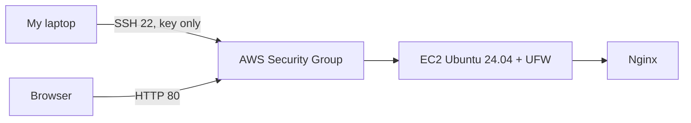

# Linux, Networking & Cloud Infrastructure Lab

Deploying and securing a Linux web server on AWS EC2, covering Linux administration, networking fundamentals and cloud firewalls.

## Objectives
1. Linux CLI: files, permissions, users, groups, processes, services, SSH keys
2. Networking: IP addressing, DNS, ports, firewalls, security groups
3. Deploy a Linux server: create VM, configure Linux, secure access, deploy a service, test connectivity

## Architecture

| Item | Value |
|---|---|
| Cloud | AWS EC2, region Asia Pacific (Sydney) |
| Instance | t3.micro (free plan) |
| OS | Ubuntu Server 24.04 LTS |
| Service | Nginx web server |
| DNS | DuckDNS subdomain pointing to the public IP |

## Documentation
- [01 - Linux basics](01-linux-basics.md): files, permissions, users and groups, processes, services, SSH keys
- [02 - Networking](02-networking.md): IP addressing, DNS, ports, security group and UFW
- [03 - Deployment](03-deployment.md): Nginx deployment and connectivity testing

Scripts are in [`scripts/`](scripts/), configuration files in [`configs/`](configs/) and screenshots in [`screenshots/`](screenshots/).

## What I did
1. Launched an Ubuntu EC2 instance with an ED25519 key pair.
2. Connected over SSH and practised the Linux CLI.
3. Created my own SSH key, then disabled password login and root login.
4. Examined IP addressing, DNS records and listening ports.
5. Configured two firewall layers: the AWS security group and UFW.
6. Deployed Nginx with a custom page and tested connectivity layer by layer.

## Security measures
| Measure | Why |
|---|---|
| Key-only SSH (`PasswordAuthentication no`) | blocks password guessing |
| `PermitRootLogin no`, `MaxAuthTries 3` | limits attack surface |
| SSH allowed only from my own IP in the security group | least privilege |
| UFW allows only ports 22 and 80 | second firewall layer |
| Private keys kept out of the repo (`.gitignore`) | no secrets published |

## Connectivity test results
| Layer | Test | Result |
|---|---|---|
| Service | `curl -I http://localhost` | 200 OK |
| Port | `ss -tlnp \| grep :80` | Nginx listening |
| OS firewall | `ufw status` | 22 and 80 allowed |
| Cloud firewall | `Test-NetConnection <PUBLIC_IP> -Port 80` | True |
| End to end | browser to `http://<PUBLIC_IP>` | page loads |

**Firewall experiment:** removing the HTTP rule from the security group made the page time out. Denying port 80 in UFW did the same even with the security group open, so traffic must pass both layers.

## Troubleshooting
- **[Problem 1, for example: SSH said "UNPROTECTED PRIVATE KEY FILE"]**: [how you fixed it, for example by resetting the file permissions with `icacls` so only my user could read it]
- **[Problem 2, for example: the security group showed an IPv6 address for "My IP"]**: [how you fixed it, for example by using a custom IPv4 `/32` source]
- **[Problem 3, optional]**: [fix]

## What I learned
- [Your own lesson, in your own words, for example that a blocked connection can be caused by either firewall layer]
- [Another lesson]

## Reproduce
See [`scripts/setup.sh`](scripts/setup.sh) for the server setup commands.

## Cleanup
After finishing, the instance was stopped or terminated to avoid charges.